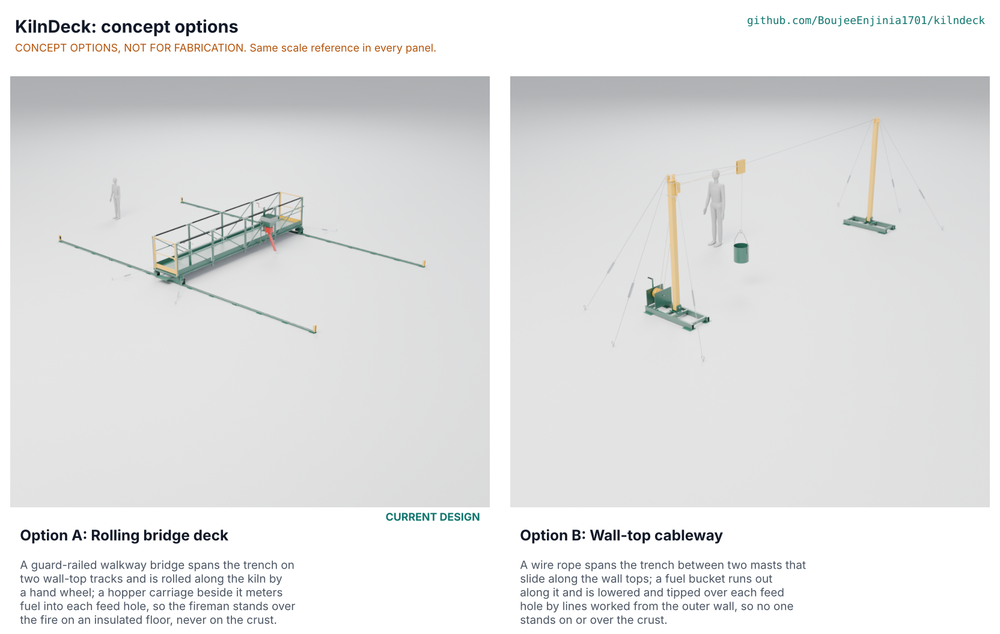

# KilnDeck concept options

Recommendation: keep option A, the rolling bridge deck, which scores 152 of 190 against 124 for option B, the wall-top cableway (18 % apart); the choice is proposed, awaiting Amish (KND-DEC-001 D10, KND-DDR-003). Method: STANDARDS section 21.

*Figure 1. The two options, each drawn from its D3 model in `cad/src/model.py` at one scale with a 1.75 m person (rendered by `.kit/options.py` on Amish's Mac).*

## The options

### Option A: rolling bridge deck (the current design)

A guard-railed walkway bridge spans the 6 m trench on two wall-top tracks and is rolled along the kiln by a hand wheel; a hopper carriage beside it meters fuel into each feed hole, so the fireman stands over the fire on an insulated floor, never on the crust. This is the design taken to TRL 3 on 2026-10-03 (KND-DDR-001, KND-DDR-002); the kit 1.9 upgrade models it part by part without changing its working principle. Key risks: floor heat in full sun (PR-007 not met), the wall bearing limit (survey), the 40 kg pieces (D14) and storms (fixed by D12). Needs from a co-design partner: a kiln survey, firemen's views on working over the fire, and space on the wall tops to stock fuel.

### Option B: wall-top cableway

A wire rope spans the trench between two guyed masts that stand on skids on the wall tops. A trolley runs along the rope; a fuel bucket hangs from it on a lowering line, and the fireman, standing on the outer wall top beyond the skid, runs the trolley out with a haul line and lowers and tips the bucket over each feed hole with a two-drum hand winch. The skids slide 1 m along the walls for each row of holes. No one stands on or over the crust. Key risks: aiming a swinging bucket into a 150 mm hole by lines, dumping a whole bucket rather than a dose, resetting six guy anchors for every row, rope wear in heat and dust, and a heavy load hanging over the fire. Needs from a co-design partner: whether owners accept guy anchors in the yard beside the kiln, and a trial of aiming by line.

## First-order numbers

*Table 1. Options compared (all estimates; masses and part counts from `cad/fidelity.json`).*

| Quantity | Option A | Option B |
| --- | --- | --- |
| Estimated parts cost (USD) | 2,787 (BOM) | about 900 (estimate from the model mass and bought rope, sheaves, anchors and turnbuckles; not priced line by line) |
| Mass (kg) | 1,202.7 (deck, carriage, 2 x 12 m of track, storm tie-downs) | 260.0 (two masts and skids, guys, anchors, rope, trolley, bucket, winch) |
| Throughput | 18 holes in a 17.5 min round, about 0.49 kg a pocket, 52 L hopper | about 52 s a hole against the 58 s the round allows (STM B4); 22 L bucket, about 10 holes a fill |
| Effort | 65 N at the hand wheel rim; 12 N at the crank | about 470 N to slide a skid (two people); winch crank light |
| Parts count (made, bought, fasteners, welds) | 1,835 parts (515 made or bought, 861 fasteners, 459 welds) | 252 parts (103 made or bought, 113 fasteners, 36 welds) |
| STEM check | Open: 10 rows plausible (S3, S9, S11, S15, S17, S18, S19, S20, S21, S23); S22 to Amish; S8 closed by a fix | Within known science on B1, B2, B5; B3 and B4 plausible; shares S1, S9 and S21 |

## Scoring

*Table 2. Weighted scoring (weights: High UR 3, Medium 2, Low 1; scores 1 to 5).*

| Criterion | Source | Weight | A | B | Reason |
| --- | --- | --- | --- | --- | --- |
| Off the crust | UR-001 | 3 | 5 | 5 | Both keep the fireman off the crust |
| No fall | UR-002 | 3 | 5 | 3 | A: 1.1 m guardrail all round; B: the fireman works at the trench edge of the wall top behind a short rail |
| Keep the round, fuel in the hole | UR-003 | 3 | 4 | 2 | A: spout within 17 mm; B: aiming a swinging bucket by line, about 52 s a hole against 58 s |
| By hand | UR-004 | 3 | 5 | 4 | Both manual; B needs two lines worked together |
| Less heat | UR-005 | 3 | 3 | 4 | A stands over the fire (floor 74 °C in full sun); B on the wall top beside it |
| Fits my kiln | UR-007 | 3 | 4 | 3 | A: pads at 0.15 MPa; B: mast skids plus six anchors in the yard per wall |
| Two-person carry | UR-008 | 3 | 3 | 3 | A: 40 kg truss modules (D14); B: a 2.4 m SHS 100 x 5 mast is about 35 kg |
| Stays put | UR-013 | 3 | 4 | 3 | A: lock pin, stops, storm clamps; B: the bucket hangs on a winch pawl over the fire |
| Steady dose | UR-006 | 2 | 4 | 2 | A: metering rotor; B: the bucket is tipped by eye |
| Moves with the fire | UR-009 | 2 | 4 | 2 | A: relay 3 m track modules; B: move both skids and reset six anchors every row |
| Affordable | UR-010 | 2 | 3 | 4 | A USD 2,787; B about USD 900 (estimate) |
| Local build | UR-011 | 2 | 4 | 3 | B needs wire rope terminations and a winch |
| Season-proof | UR-012 | 2 | 4 | 3 | B: rope and guys wear in heat, dust and storms |
| Easy upkeep | UR-014 | 1 | 3 | 3 | A: chains and many bolts; B: rope inspection |
| Safety overall | STANDARDS s21 | 3 | 4 | 4 | A carries a person over the fire but guarded; B keeps people off the deck but hangs loads over it |
| **Weighted total (of 190)** | | | **152** | **124** | A 80 %, B 65 % |

Cost against the value-engineering target, buildability and maintenance are scored through UR-010, UR-011 and UR-014.

## Recommendation

Option A, proposed, awaiting Amish (KND-DEC-001 D10). It scores 18 % above option B, so it is not a choice within 10 %. Option A also carries the whole TRL 3 record (calculation note, drawings, build plan). The runner-up's best idea to graft onto it: a small wall-top cableway from the outer wall could serve the curved kiln ends, which option A does not reach (PR-001), or lift fuel to the hopper's refill point; both are suggestions for a later stage, not added here.
